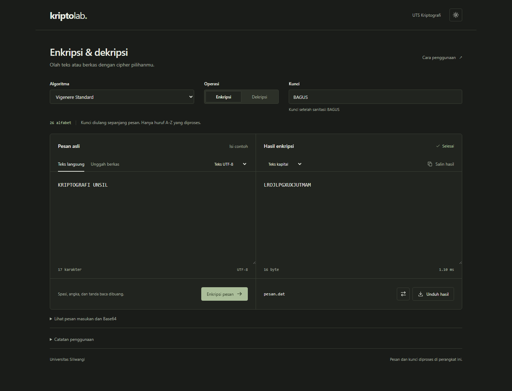
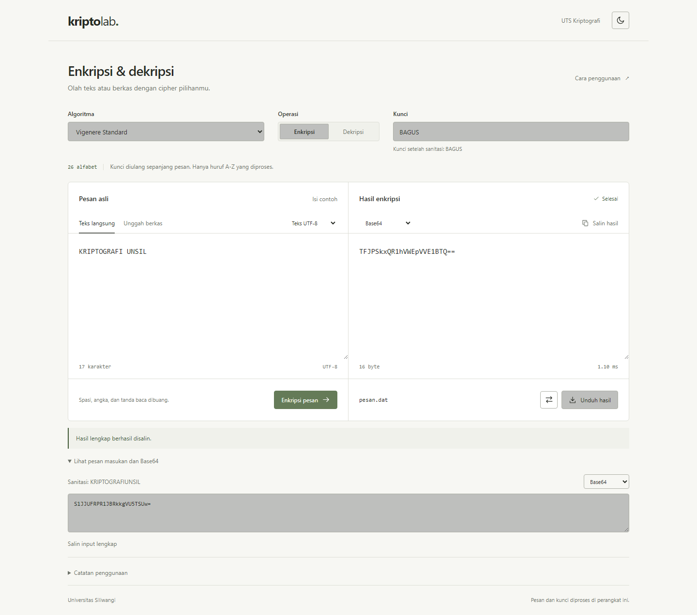
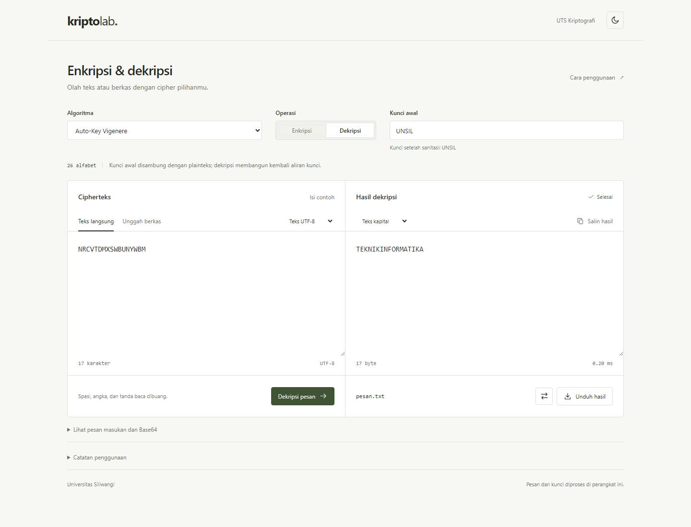
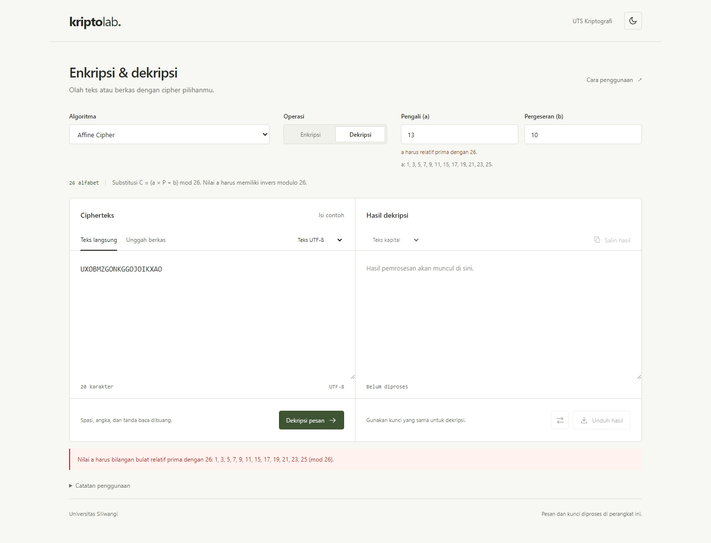
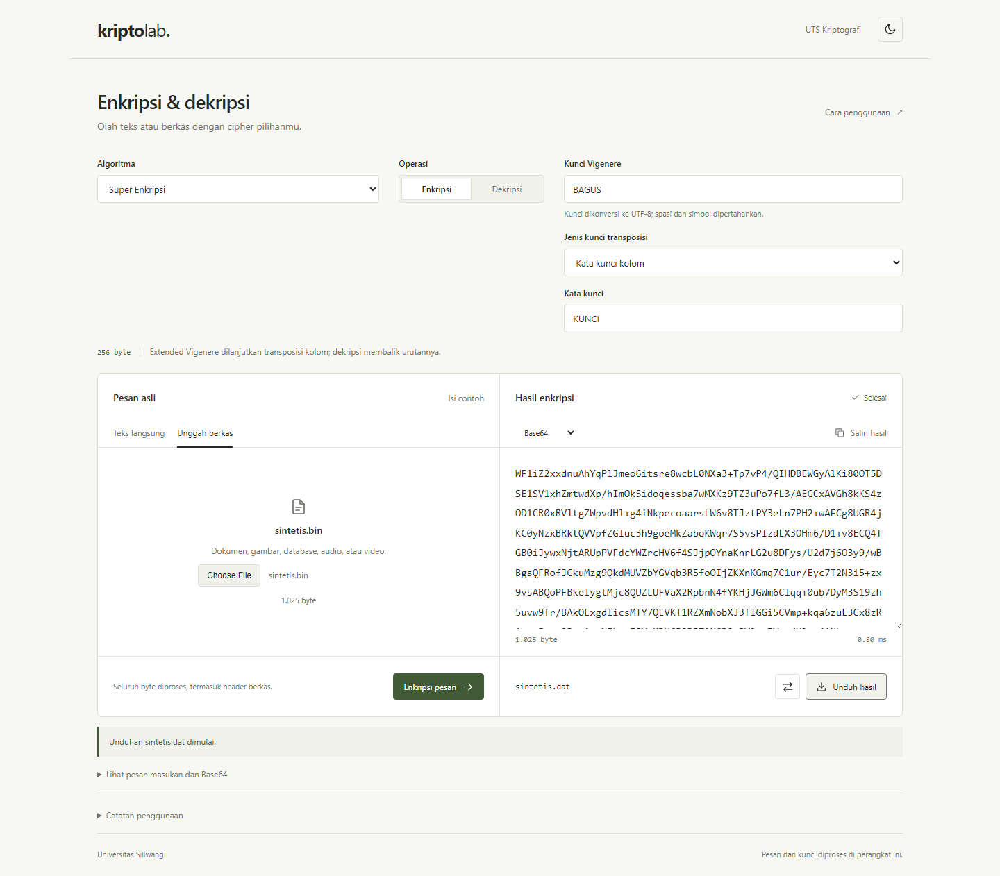
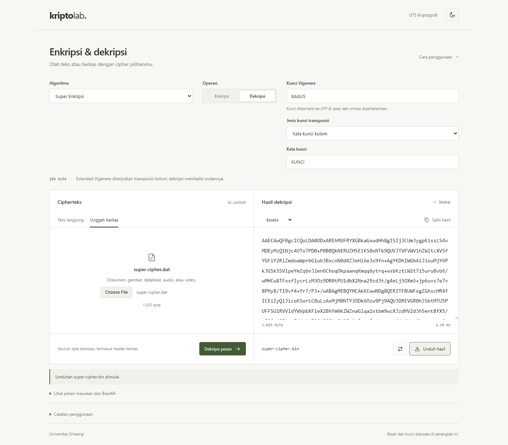
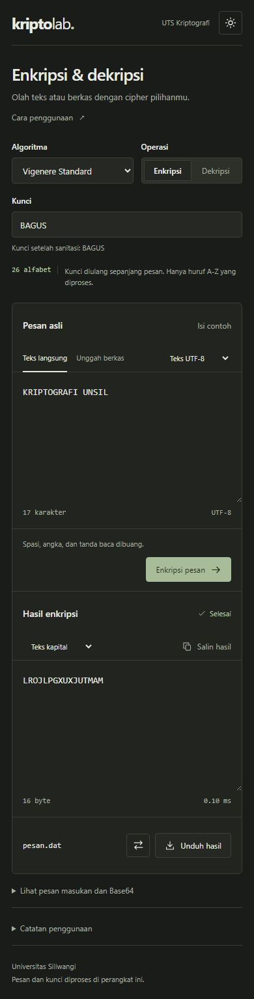
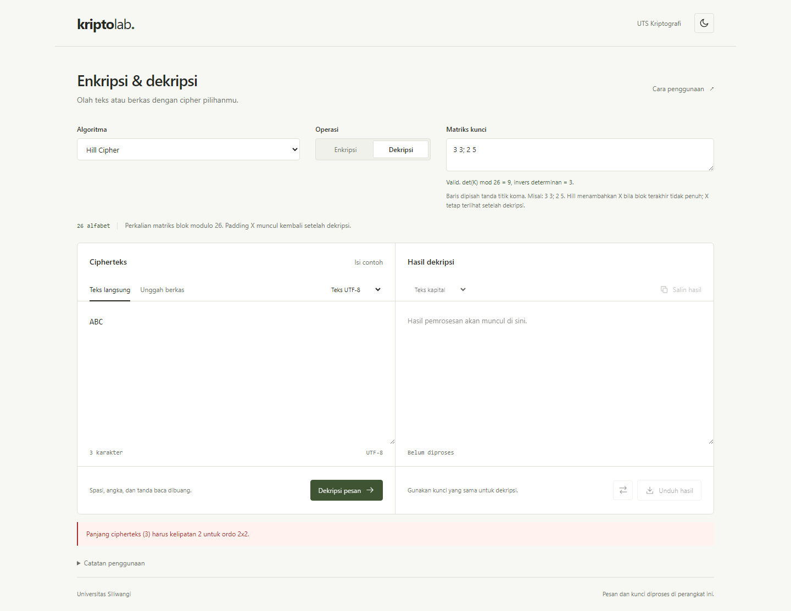

# Laporan Bagian Anggota 1

## KriptoLab — Project UTS Kriptografi

Program Studi Informatika, Fakultas Teknik, Universitas Siliwangi. Dosen pengampu: Ir. Randi Rizal, Ph.D.

Lingkup: antarmuka web, sanitizer, Vigenere Standard, Auto-Key Vigenere, Affine Cipher, serta integrasi antarmuka dengan modul kelompok yang telah tersedia.

Identitas penyusun: [konfirmasi nama dan NPM Anggota 1 sebelum laporan digabungkan]. Kontrak resmi menempatkan Dhiya Ulhaq Prima Yuga (237006066) sebagai Anggota 1, sedangkan catatan teknis mencantumkan penyusun Arya Achmad Caesar. Paket ini mengikuti peran Anggota 1 sesuai instruksi pengguna.

Status dokumen: materi serah terima bagian Anggota 1, bukan laporan akhir seluruh kelompok. Hill telah diintegrasikan; QA lima media nyata dan kompilasi laporan kelompok masih menunggu.

Tanggal penyusunan: 8 Oktober 2026. Waktu bukti browser (UTC): 2026-10-08T05:15:04.562Z.

# BAB I. Pendahuluan

## 1.1 Latar belakang

Praktikum kriptografi memerlukan antarmuka yang menghubungkan konsep transformasi pesan dengan hasil yang dapat diperiksa. KriptoLab menyediakan ruang kerja untuk memilih cipher, memasukkan kunci, mengenkripsi atau mendekripsi pesan, dan meninjau representasi Base64. Pembedaan cipher alfabet dan cipher byte ditampilkan agar pengguna memahami data yang dipertahankan selama pemrosesan.

## 1.2 Tujuan

Tujuan bagian Anggota 1 adalah mengimplementasikan tiga cipher klasik sesuai kontrak fungsi kelompok; menyediakan sanitasi alfabet A–Z; membangun antarmuka responsif untuk teks dan berkas; menghubungkan modul yang tersedia; serta menyiapkan bukti pengujian dan tangkapan layar untuk laporan kelompok.

## 1.3 Ruang lingkup dan pembagian

| Peran | Lingkup |
| --- | --- |
| Anggota 1 | GUI, sanitizer, Vigenere Standard, Auto-Key, Affine, helper tampilan, materi UI/Bab I. |
| Anggota 2 | Playfair, Extended Vigenere, Super, Enigma, kontainer KRIP. Bahan tersedia dan diintegrasikan. |
| Anggota 3 | Hill 2x2/3x3, QA lima media nyata, kompilasi laporan akhir dan README kelompok. |

Teks alfabet dipulihkan sebagai hasil sanitasi, sehingga spasi, angka, dan tanda baca tidak kembali. Pemulihan byte mentah beserta format file memakai Extended Vigenere atau Super Enkripsi. Implementasi menggunakan JavaScript/TypeScript sehingga bonus Ruby tidak diterapkan.

# BAB II. Rancangan dan Algoritma Anggota 1

## 2.1 Arsitektur aplikasi

Next.js 16.4.0 menyediakan halaman dan aset aplikasi. Komponen interaktif berjalan sebagai Client Component dengan React. Alur pemrosesan: form pengguna → Uint8Array melalui TextEncoder/File.arrayBuffer → processRequest → modul cipher → tampilan dan Blob unduhan. Pesan, file, serta kunci diproses di browser. Tidak ada endpoint server untuk mengirimkan data kriptografi.

## 2.2 Sanitasi dan representasi

sanitizeText(text) membuang karakter selain a–z/A–Z sebelum mengubah menjadi huruf kapital. Contoh: Halo, Dunia 123! menjadi HALODUNIA. Penyaringan sebelum uppercase mencegah huruf non-ASCII yang berubah menjadi ASCII saat uppercase ikut masuk. Kunci Vigenere dan Auto-Key juga disanitasi; kunci yang tidak menyisakan huruf ditolak.

Base64 mengubah representasi byte menjadi teks dan tidak menambah kerahasiaan. Helper mengonversi string menjadi UTF-8 terlebih dahulu. Besar/kecil huruf Base64 dipertahankan; format huruf kapital/kecil hanya diterapkan pada keluaran cipher alfabet. Pratinjau layar dibatasi 12.000 karakter, tetapi salin dan unduh menggunakan hasil lengkap.

## 2.3 Vigenere Standard

Huruf dipetakan A=0 hingga Z=25. Dengan panjang kunci m, enkripsi memakai C[i]=(P[i]+K[i mod m]) mod 26. Dekripsi memakai P[i]=(C[i]−K[i mod m]+26) mod 26. Kunci berulang sepanjang pesan. Contoh pemeriksaan independen: ATTACKATDAWN dengan LEMON menghasilkan LXFOPVEFRNHR.

## 2.4 Auto-Key Vigenere

Aliran kunci dibentuk dari kunci awal diikuti plainteks, bukan pengulangan kunci. Enkripsi memakai C[i]=(P[i]+S[i]) mod 26. Dekripsi dilakukan berurutan: setelah posisi kunci awal terlewati, huruf plainteks yang sudah ditemukan menjadi kunci untuk posisi berikutnya. ATTACKATDAWN dengan QUEENLY menghasilkan QNXEPVYTWTWP. Memakai cipherteks sebagai tambahan aliran kunci akan menghasilkan varian yang berbeda dan tidak sesuai kontrak tugas ini.

## 2.5 Affine Cipher

Enkripsi memakai C=(aP+b) mod 26, sedangkan dekripsi memakai P=a⁻¹(C−b) mod 26. Parameter a harus integer yang relatif prima dengan 26 dan b harus integer 0–25. Nilai a valid modulo 26 ialah 1,3,5,7,9,11,15,17,19,21,23,25. Invers dicari dengan menguji a·x mod 26=1. Untuk a=7 diperoleh invers 15. Input a=13 ditolak pada GUI dan fungsi karena tidak memiliki invers.

## 2.6 Integrasi berkas

File dienkripsi sebagai byte mentah oleh Extended/Super, lalu dibungkus: 4 byte KRIP + 1 byte panjang ekstensi + ekstensi ASCII + payload terenkripsi. Header asli file berada di dalam payload dan ikut dienkripsi; KRIP merupakan header kontainer baru. unpackageBinaryFile mengembalikan originalExtension dan encryptedBytes sesuai kontrak resmi, kemudian payload didekripsi. Algoritma/kunci tidak disimpan dalam kontainer dan harus ditentukan pengguna.

Input dibatasi 10 MiB; unggahan dekripsi diperbolehkan memiliki tambahan maksimum 260 byte header kontainer agar batas tersebut tetap dapat dipulihkan. File alfabet hanya diproses sebagai teks UTF-8 dan hasil dekripsinya diunduh sebagai .txt. File tanpa ekstensi pada jalur byte menggunakan .bin.

# BAB III. Antarmuka dan Cara Penggunaan

Antarmuka dibagi menjadi konfigurasi cipher, masukan, dan hasil. Form kunci berubah sesuai algoritma: teks untuk Vigenere/Auto-Key, pengali dan pergeseran untuk Affine, matriks untuk Hill, kunci transposisi untuk Super, serta rotor/ring/reflektor/plugboard untuk Enigma. Tema gelap/terang disimpan sebagai preferensi lokal. Layout dua kolom menjadi satu kolom pada layar kecil.

Alur teks: pilih cipher → tentukan kunci → ketik pesan → Enkripsi pesan → tinjau hasil → Balikkan proses → Dekripsi pesan. Alur file: pilih cipher byte → unggah file → enkripsi → Unduh hasil .dat → pilih Dekripsi dan unggah .dat → unduh file dengan ekstensi semula. Jika memakai hasil salinan, pilih encoding Base64 untuk payload byte. Metadata ekstensi hanya dipertahankan melalui kontainer .dat.

Hill menyediakan masukan matriks 2x2 atau 3x3 dengan validasi determinan langsung; tombol proses nonaktif jika matriks tidak valid. Padding X dipertahankan pada dekripsi. Pesan kesalahan ditampilkan dekat hasil dengan role alert; perubahan parameter membersihkan hasil lama untuk menghindari keluaran yang tidak sesuai konfigurasi saat ini.

# BAB IV. Pengujian Bagian Anggota 1

Pengujian logika memakai test runner bawaan Node.js: 14 kelompok uji mencakup known-answer, round trip, sanitasi Unicode, kunci tidak valid, semua nilai a valid dan b 0–25, Base64, kontainer rusak, integrasi byte, batas ukuran 10 MiB, dan status Hill. Uji browser otomatis dijalankan pada Chromium 151.0.7922.34 terhadap build produksi lokal; 13 pemeriksaan tercatat tanpa page error, termasuk vektor Hill HELP -> HIAT dan round-trip di GUI.

| Cipher | Plainteks tersanitasi | Cipherteks | Dekripsi |
| --- | --- | --- | --- |
| Vigenere | KRIPTOGRAFIUNSIL | LROJLPGXUXJUTMAM | Sesuai |
| Auto-Key | TEKNIKINFORMATIKA | NRCVTDMXSWBUNYWBM | Sesuai |
| Affine | UNIVERSITASSILIWANGI | UXOBMZGONKGGOJOIKXAO | Sesuai |
| Hill | HELP | HIAT | Sesuai |

Kunci contoh: Vigenere BAGUS; Auto-Key UNSIL; Affine a=7 dan b=10. File teks sintetis berisi Halo, Dunia! 123 diikuti baris Kriptografi. dipulihkan sebagai HALODUNIAKRIPTOGRAFI oleh ketiga cipher Anggota 1.

Pengujian browser juga mengunduh dan mengunggah kembali berkas sintetis 1.025 byte pada Extended dan Super. Byte hasil dibandingkan langsung dengan input, dan SHA-256 dicatat dalam browser-results.json. Hal ini membuktikan kesamaan byte untuk fixture yang diuji; tidak menggantikan bukti lima media asli, pengujian pemutar audio/video, atau penilaian keamanan algoritma.

| Aspek | Hasil / batas bukti |
| --- | --- |
| Vigenere, Auto-Key, Affine | Known-answer, round trip teks, upload/download teks tersanitasi lulus. |
| Sanitizer / Base64 | Filter A–Z, UTF-8, byte 0–255, input tidak valid, clipboard browser lulus. |
| UI | Tema gelap/terang, persistensi tema, error Affine, layar 390 px tanpa overflow horizontal lulus. |
| Integrasi Anggota 2 | Byte sintetis Extended/Super lulus; known-answer Playfair/Enigma lulus pada uji logika. |
| Hill | Vektor 2x2/3x3, padding dan validasi matriks lulus. |
| QA lima media asli | Belum dilakukan dalam paket Anggota 1; dilanjutkan Anggota 3. |

Validasi build/lint dan log test disimpan di docs/bukti. Tabel evaluasi sembilan butir final wajib disusun setelah seluruh kelompok menyelesaikan integrasi serta QA; tabel rencana pada breakdown tidak disalin menjadi klaim keberhasilan.

# BAB V. Kesimpulan dan Serah Terima

Bagian Anggota 1 menyediakan antarmuka yang dapat dijalankan, tiga cipher klasik sesuai kontrak, sanitasi, Base64, dan alur file terintegrasi. Pengujian yang dijalankan mendukung hasil pada kasus uji yang didokumentasikan. Keluaran alfabet tidak memulihkan karakter yang dibuang, sedangkan jalur byte memulihkan fixture yang diuji secara identik.

Anggota 3 perlu menguji dokumen/gambar/database/audio/video nyata, melengkapi tabel sembilan butir, dan menggabungkan laporan kelompok. Hill sudah tersedia di aplikasi. Anggota 2 perlu meninjau penjelasan teknis modul biner dan cipher miliknya. Identitas penyusun serta tenggat Classroom perlu dicocokkan sebelum penyerahan.

## Acuan pekerjaan

Soal UTS Kriptografi 20261.pdf: naskah lokal 3 halaman, spesifikasi program, GUI, file, dan laporan.

breakdown tugas.txt; KONTRAK_INTERFACE_DAN_FUNGSI.txt; CATATAN_DAN_PANDUAN_ANGGOTA_1.txt; ALUR_KERJA_DAN_URUTAN_PENGERJAAN.txt: bahan lokal pembagian dan kontrak kelompok.

Folder bahan ../src: sumber awal UI dan modul; disalin lalu disesuaikan di proyek uts-kriptografi. Atribusi modul Anggota 2 dipertahankan.

Panduan lokal Next.js 16.4.0: node_modules/next/dist/docs/01-app/01-getting-started, bagian layouts/pages, server/client components, dan CSS.

tests/ciphers.test.mjs; tests/browser-smoke.mjs; docs/bukti/browser-results.json: prosedur dan bukti pengujian aktual.

# Lampiran A.1. Vigenere Standard — tema gelap

Pesan contoh KRIPTOGRAFI UNSIL, kunci BAGUS, dan hasil enkripsi yang dihitung aplikasi.



# Lampiran A.2. Representasi Base64 — tema terang

Payload hasil serta pesan input ditampilkan dalam Base64. Salin hasil diuji melalui clipboard browser.



# Lampiran A.3. Dekripsi Auto-Key

Plainteks dipulihkan melalui tombol Balikkan proses dengan kunci awal UNSIL.



# Lampiran A.4. Validasi Affine

Parameter a=13 tidak relatif prima dengan 26 sehingga pemrosesan ditolak dengan pesan kesalahan.



# Lampiran A.5. Enkripsi dan unduhan .dat

File sintetis 1.025 byte dienkripsi melalui Super. Ini bukti alur GUI, bukan media asli final kelompok.



# Lampiran A.6. Pemulihan file dari .dat

File .dat hasil unduhan diunggah kembali; hasil dekripsi dibandingkan byte demi byte dengan fixture asli.



# Lampiran A.7. Antarmuka mobile 390 px

Layout satu kolom; pengujian memeriksa tidak ada overflow horizontal pada viewport ini.



# Lampiran A.8. Hill Cipher dan validasi input

Matriks 2×2 valid. Dekripsi ABC ditolak kerana panjang cipherteks bukan kelipatan ordo.



# Lampiran B. Kode Modul Anggota 1

Kode di bawah diambil langsung dari implementasi yang diuji. Kode GUI dan integrasi lengkap tersedia di components/CipherWorkbench.jsx, app/globals.css, dan src/lib/workbench.js dalam paket proyek; modul anggota lain tetap berada di src/modules.

## sanitizer.js

```js
/** Kontrak Anggota 1: alfabet ASCII A-Z saja. */
export function sanitizeText(text) {
  if (typeof text !== "string") throw new TypeError("Teks harus berupa string.");
  return text.replace(/[^a-zA-Z]/g, "").toUpperCase();
}

export function requireAlphabetKey(key) {
  const clean = sanitizeText(key);
  if (!clean) throw new Error("Kunci harus mengandung setidaknya satu huruf A-Z.");
  return clean;
}
```

## vigenere_standard.js

```js
import { sanitizeText, requireAlphabetKey } from "./sanitizer.js";

function transform(text, key, direction) {
  const clean = sanitizeText(text);
  const seed = requireAlphabetKey(key);
  return Array.from(clean, (letter, i) => String.fromCharCode(
    (letter.charCodeAt(0) - 65 + direction * (seed.charCodeAt(i % seed.length) - 65) + 26) % 26 + 65
  )).join("");
}

export function encryptVigenereStandard(plaintext, key) { return transform(plaintext, key, 1); }
export function decryptVigenereStandard(ciphertext, key) { return transform(ciphertext, key, -1); }
```

## autokey_vigenere.js

```js
import { sanitizeText, requireAlphabetKey } from "./sanitizer.js";

export function encryptAutoKeyVigenere(plaintext, key) {
  const plain = sanitizeText(plaintext);
  const stream = requireAlphabetKey(key) + plain;
  return Array.from(plain, (letter, i) => String.fromCharCode(
    (letter.charCodeAt(0) + stream.charCodeAt(i) - 130) % 26 + 65
  )).join("");
}

export function decryptAutoKeyVigenere(ciphertext, key) {
  const cipher = sanitizeText(ciphertext);
  const seed = requireAlphabetKey(key);
  const plain = [];
  for (let i = 0; i < cipher.length; i++) {
    const k = i < seed.length ? seed[i] : plain[i - seed.length];
    plain.push(String.fromCharCode((cipher.charCodeAt(i) - k.charCodeAt(0) + 26) % 26 + 65));
  }
  return plain.join("");
}
```

## affine_cipher.js

```js
import { sanitizeText } from "./sanitizer.js";

export const AFFINE_A_VALUES = [1, 3, 5, 7, 9, 11, 15, 17, 19, 21, 23, 25];
export function modInverse(a, m = 26) {
  if (!Number.isSafeInteger(a) || !Number.isSafeInteger(m) || m < 2) return null;
  const value = ((a % m) + m) % m;
  for (let x = 1; x < m; x++) if ((value * x) % m === 1) return x;
  return null;
}

export function validateAffine(a, b) {
  if (!Number.isSafeInteger(a) || modInverse(a) === null) {
    throw new Error("Nilai a harus bilangan bulat relatif prima dengan 26: 1, 3, 5, 7, 9, 11, 15, 17, 19, 21, 23, 25 (mod 26).");
  }
  if (!Number.isInteger(b) || b < 0 || b >= 26) throw new Error("Nilai b harus bilangan bulat dari 0 sampai 25.");
}

export function encryptAffine(plaintext, a, b) {
  validateAffine(a, b);
  const normalizedA = ((a % 26) + 26) % 26;
  return Array.from(sanitizeText(plaintext), ch => String.fromCharCode((normalizedA * (ch.charCodeAt(0) - 65) + b) % 26 + 65)).join("");
}

export function decryptAffine(ciphertext, a, b) {
  validateAffine(a, b);
  const inverse = modInverse(a);
  return Array.from(sanitizeText(ciphertext), ch => String.fromCharCode((inverse * (ch.charCodeAt(0) - 65 - b + 26)) % 26 + 65)).join("");
}
```

## display_helpers.js

```js
export function bytesToBase64(bytes) {
  if (!(bytes instanceof Uint8Array)) throw new TypeError("Data harus berupa Uint8Array.");
  const chunks = [];
  for (let i = 0; i < bytes.length; i += 32768) chunks.push(String.fromCharCode(...bytes.subarray(i, i + 32768)));
  return btoa(chunks.join(""));
}

export function base64ToBytes(value) {
  const clean = value.replace(/\s/g, "");
  if (!/^(?:[A-Za-z0-9+/]{4})*(?:[A-Za-z0-9+/]{2}==|[A-Za-z0-9+/]{3}=)?$/.test(clean)) {
    throw new Error("Base64 tidak valid. Gunakan Base64 standar beserta padding = jika diperlukan.");
  }
  return Uint8Array.from(atob(clean), ch => ch.charCodeAt(0));
}

export function toBase64(textString) { return bytesToBase64(new TextEncoder().encode(textString)); }

export function formatScreenOutput(text, mode) {
  if (mode === "BASE64") return toBase64(text);
  if (mode === "UPPERCASE_NO_SPACE") return text.replace(/\s/g, "").toUpperCase();
  if (mode === "LOWERCASE_NO_SPACE") return text.replace(/\s/g, "").toLowerCase();
  throw new Error("Mode tampilan tidak dikenal.");
}
```
